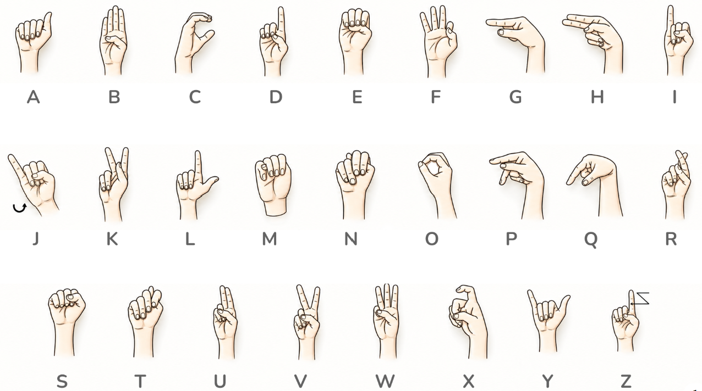

# Sign Language to Speech (ASL, 15 classes)

A real-time computer vision app that reads American Sign Language (ASL) hand
signs from a webcam, turns them into text, and reads the text aloud.

```
Webcam  ->  MediaPipe (21 hand points)  ->  Random Forest  ->  text  ->  voice
```

You record your own training data with the webcam, train the model in a few
seconds, then run the live app. No GPU, no large dataset and no deep learning
training are needed.

---

## 1. How it works

The project runs in three steps, one script each:

| Step | Script | What it does |
|---|---|---|
| 1. Collect | `collect_data.py` | Records your hand signs from the webcam and saves them to `data/landmarks.csv` |
| 2. Train | `train.py` | Trains a Random Forest classifier and saves it to `model.joblib` |
| 3. Run | `app.py` | Recognizes signs live, builds a sentence, and speaks it |

### From image to features

The model never looks at raw images. For every webcam frame:

0. The webcam image is **mirrored** (flipped left-right, like a selfie), both
   when collecting data and in the live app, so moving your hand to the right
   moves it to the right on screen.
1. **MediaPipe Hands** (a pretrained Google model) finds the hand and returns
   **21 landmarks** (wrist, finger joints, fingertips), each with `x, y, z`
   coordinates.
2. `features.py` normalizes these points so that only the **shape** of the hand
   matters:
   - the wrist becomes the origin, so the hand's **position** in the frame does
     not matter;
   - points are divided by the hand's size, so the **distance to the camera**
     does not matter.
3. The result is a vector of **63 numbers** (21 points x 3 coordinates).

The same function is used during data collection and in the live app, so the
model always receives exactly the same kind of input.

### Classification

A **Random Forest** (300 decision trees, from scikit-learn) learns to map the 63
numbers to one of the 15 classes. Because the input is a small, clean set of
landmarks instead of thousands of pixels, a few hundred samples per class are
enough, and the result is robust to lighting, background and skin tone.

### Stable recognition in the live app

A prediction is used only if:

- the model is at least **70% confident** (`CONF_THRESHOLD`), and
- the same sign wins **9 of the last 12 frames** (`NEEDED` / `WINDOW`), which
  means you hold it steadily for about half a second.

A green progress bar on screen fills up while you hold a sign. Each sign is
added **only once per hold**: to type the same letter twice (for example
`L`, `L`), drop your hand briefly between the two.

---

## 2. The classes

The reference chart used to choose and perform the signs is the ASL alphabet:



The training data itself is **not** taken from this image. It is recorded with
your own webcam (step 1). The chart is the visual guide for how each sign
should look.

The project recognizes **15 classes**: 11 letters and 4 control gestures.

### 11 letters

`A  B  C  D  F  I  L  O  V  W  Y`

These letters were chosen because they are **static** (no movement is needed,
unlike `J` and `Z`) and they look **clearly different** from each other.
Letters such as `M`, `N`, `S`, `T` and `E` are all variations of a closed fist
and would be easily confused, so they are left out.

| Letter | Hand shape |
|---|---|
| A | Fist, thumb resting against the side of the index finger |
| B | Flat hand, fingers together and pointing up, thumb folded on the palm |
| C | Curved hand shaped like the letter C |
| D | Index finger up, other fingers touching the thumb |
| F | Thumb and index touching (OK sign), other 3 fingers up |
| I | Fist with only the pinky up |
| L | Thumb and index forming an L |
| O | All fingertips touching the thumb, forming an O |
| V | Index and middle fingers up, spread (peace sign) |
| W | Index, middle and ring fingers up and spread |
| Y | Thumb and pinky out, other fingers folded |

### 4 control gestures

These are actions, not letters. They let you write and speak a sentence
without touching the keyboard.

| Gesture | Hand shape | Effect on the text |
|---|---|---|
| `SPACE` | Open hand, all 5 fingers spread, palm to camera | Adds a space |
| `DELETE` | Fist with the thumb pointing **down** | Deletes the last character |
| `SPEAK` | Fist with the thumb pointing **up** | Reads the whole text aloud |
| `I_LOVE_YOU` | Thumb, index and pinky out (ASL "I love you") | Adds the words `I LOVE YOU ` |

All classes and their descriptions are defined in `classes.py`. You can change
any gesture there, since you record the data yourself; just keep the gestures
visually different from each other.

---

## 3. Speech (text-to-speech)

The app speaks the text it has built using **pyttsx3**, an offline
text-to-speech library (no internet connection needed). It uses the voices
already installed on your computer:

- **Windows**: SAPI5 (built in)
- **macOS**: NSSpeechSynthesizer (built in)
- **Linux**: espeak (install with `sudo apt install espeak`)

Speech is triggered by the `SPEAK` gesture (thumb up) or by pressing **`s`**.

Speech runs in a **background thread** so the video never freezes while the
computer is talking. Requests are put in a queue and spoken one after the
other. A **new speech engine is created for each sentence**: on Windows,
reusing the same pyttsx3 engine in a thread only speaks the first time, so
this makes speech work every time.

If no voice engine is available, the app prints `[would say] ...` in the
terminal instead of crashing.

---

## 4. Libraries and why they are used

| Library | Used in | Why |
|---|---|---|
| `mediapipe` (0.10.14) | `features.py` | Pretrained hand detector that returns the 21 hand landmarks for each frame. This does the hard computer vision work, so we do not need to train a deep network. |
| `opencv-python` | all scripts | Opens the webcam, flips the image like a mirror, converts colors (BGR to RGB for MediaPipe), draws the landmarks, text and progress bar, and shows the window and reads key presses. |
| `numpy` | `features.py`, `app.py`, `train.py` | Fast math on arrays: normalizing the landmarks (origin, mirroring, scaling) and handling the 63-number feature vectors. |
| `pandas` | `train.py` | Loads `data/landmarks.csv` into a table and counts samples per class. |
| `scikit-learn` | `train.py` | The Random Forest classifier, the train/test split, and the evaluation (accuracy, per-class report, confusion matrix). |
| `joblib` | `train.py`, `app.py` | Saves the trained model to `model.joblib` and loads it in the app. |
| `pyttsx3` | `app.py` | Offline text-to-speech, used to read the sentence aloud. |

Standard Python modules are also used: `csv` (saving samples), `collections`
(counting votes and keeping the last frames), `threading` and `queue`
(speech in the background).

---

## 5. Requirements

- **Python 3.9 to 3.12** (MediaPipe 0.10.14 does not support newer versions).
  This project was built with Python 3.9.13.
- A **webcam**.
- Windows, macOS or Linux. On Linux, install espeak for the voice.

`requirements.txt`:

```
mediapipe==0.10.14
opencv-python
numpy
pandas
scikit-learn
joblib
pyttsx3
```

---

## 6. Installation

Create and activate a virtual environment, then install the requirements.

**Windows (PowerShell)**

```powershell
python -m venv venv
venv\Scripts\Activate.ps1
pip install -r requirements.txt
```

If PowerShell says running scripts is disabled, run this first (it only
affects the current window):

```powershell
Set-ExecutionPolicy -Scope Process -ExecutionPolicy Bypass
```

**macOS / Linux**

```bash
python3 -m venv venv
source venv/bin/activate
pip install -r requirements.txt
```

Run every script from the project folder (the one containing `app.py`),
because the paths `data/landmarks.csv` and `model.joblib` are relative to it.

---

## 7. How to use it

```bash
python collect_data.py   # 1. record samples for each class
python train.py          # 2. train the model and see the accuracy
python app.py            # 3. live demo with voice
```

**Two options:**

- **Use the data already collected.** The project comes with recorded samples
  and a trained model (`model.joblib`). `data/landmarks.csv` holds **6,000
  samples from two people** (3,000 each, 200 per class each, so 400 per class
  in total), all signed with the **right hand**. Each sample is the 63
  landmark numbers of one webcam frame, not an image.
  You can go straight to step 3 (`python app.py`), or run `train.py` first to
  retrain on this data.
- **Record your own data.** Run all three steps to build a model for your own
  hands, camera and room. You can either **add** your samples to the existing
  ones (more variety, see "Adding more data later" below), or **start from
  zero**: move or delete `data/landmarks.csv`, then run `collect_data.py`.

### Step 1: collect data

| Key | Action |
|---|---|
| `r` | Start / stop recording the current class |
| `n` / `p` | Next / previous class |
| `c` | **Delete** all samples of the current class |
| `q` | Save and quit |

- The screen shows the current class, how to make the sign, and the number of
  samples (for example `200/400`).
- Recording stops by itself when the class reaches `TARGET` samples
  (currently **400**, set at the top of `collect_data.py`). One sample is saved
  every 2 frames.
- While recording, **move your hand a little**: closer, farther, slightly
  rotated, shifted left and right. Do not hold it frozen.
- Use even lighting and, if possible, a plain background.

**Adding more data later:** running `collect_data.py` again **keeps** the old
samples and adds new ones to them. Nothing is deleted unless you press `c`.
To add more variety to classes that are already full, raise `TARGET` first
(for example from 400 to 600). It is a good idea to make a copy of
`data/landmarks.csv` before. Recording at a different time of day, in another
room, or with another person's hand is the best way to make the model work
for everyone. Keep about the same number of samples in every class, otherwise
the model tends to predict the bigger classes more often.

### Step 2: train

`train.py`:

1. prints the number of samples per class (and warns if a class has fewer
   than 30);
2. trains on 80% of the data and tests on the other 20%;
3. prints the accuracy, a per-class report, and the **most confused pairs**
   of signs;
4. retrains on **all** the data and saves `model.joblib`.

If two signs are often confused, record more varied samples for them or
change one of the two gestures in `classes.py`, then retrain.

The test score is optimistic, because neighbouring video frames look alike.
The real test is how the live app behaves.

### Step 3: live app

| Key / gesture | Action |
|---|---|
| Hold a sign ~0.5 s | Adds the letter (or does the action) once |
| `SPEAK` (thumb up) or `s` | Reads the text aloud |
| `c` | Clears the text |
| `q` | Quits |

On screen you see the predicted sign and its confidence at the top, the green
progress bar below it, and the sentence being typed at the bottom.

**Example:** sign `I_LOVE_YOU`, then `D`, `A`, `D`, then thumb up: the
computer says "I love you dad". (Only the 11 letters above can be typed; add more classes to
write more words.)

---

## 8. Tuning (top of `app.py`)

| Problem | Change |
|---|---|
| Wrong letters appear | Raise `CONF_THRESHOLD` (0.70 -> 0.80) or `NEEDED` |
| Too slow to react | Lower `NEEDED` (9 -> 6) |
| Letters flicker or repeat | Increase `WINDOW` and `NEEDED` together |

---

## 9. Troubleshooting

- **Webcam does not open:** close other apps using the camera, or try
  `cv2.VideoCapture(1)` instead of `0`. On macOS, allow camera access for the
  terminal.
- **`No model found`:** run `collect_data.py` then `train.py` first, from the
  project folder.
- **No voice on Linux:** install espeak. Without it the app prints
  `[would say] ...`.
- **`mediapipe` fails to install:** check your Python version (3.9 to 3.12).
- **Works for you but not for someone else:** collect samples from more
  people, then retrain.

---

## 10. Project files

| File | Role |
|---|---|
| `classes.py` | The 15 classes and the description of each gesture |
| `features.py` | MediaPipe wrapper and landmark normalization (shared by all steps) |
| `collect_data.py` | Records samples to `data/landmarks.csv` |
| `train.py` | Trains the Random Forest and saves `model.joblib` |
| `app.py` | Live recognition, sentence building and text-to-speech |
| `data/landmarks.csv` | Recorded samples: one row = class name + 63 numbers |
| `model.joblib` | The trained model used by the app |
| `asl_alphabets.png` | ASL alphabet reference chart |
| `requirements.txt` | Python libraries to install |

---

## 11. Limitations and next steps

**Limitations.** The app recognizes isolated, **static** hand shapes, one hand
at a time. The included data comes from two people using their right hand,
so the model works best with right-handed signing. It is not full sign
language translation, which also uses
movement, facial expressions and its own grammar.

**Possible improvements:**

1. Add more letters, keeping them visually distinct.
2. Recognize moving signs (`J`, `Z`, words such as "hello" or "thank you")
   with a sequence model (for example an LSTM) fed with about 30 frames of
   landmarks.
3. Build a web or Streamlit interface.
4. Test with several people and report the accuracy per person.
